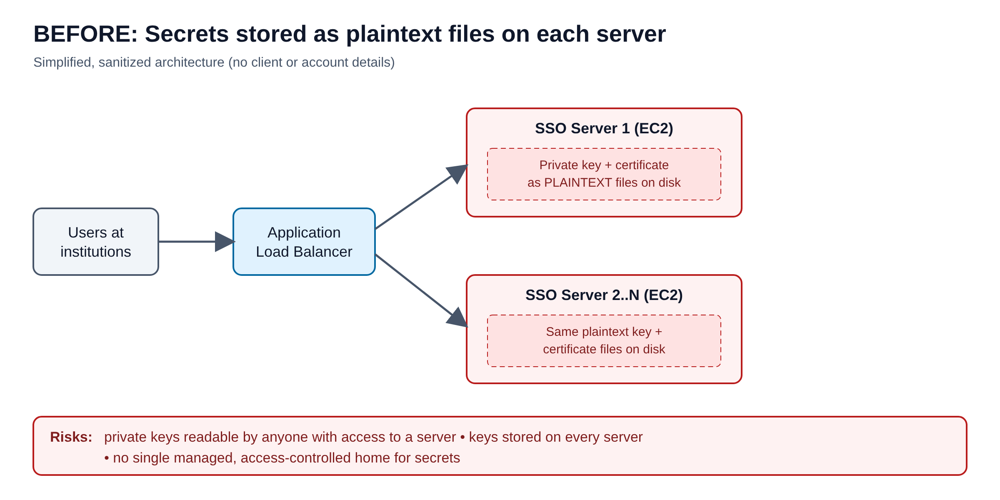
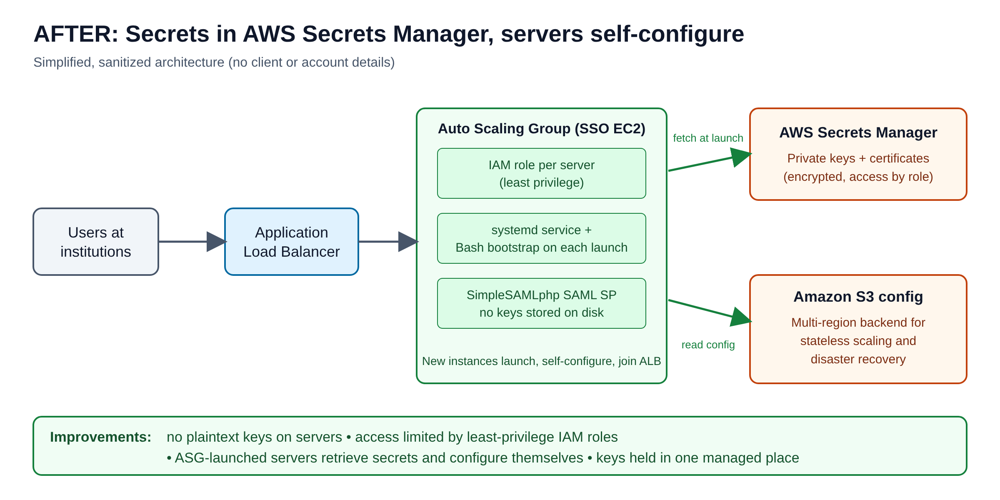

# Christian Bekheit
**Cybersecurity | Wentworth Institute of Technology (B.S., expected August 2027)**
[GitHub](https://github.com/ChristianBekheit)

---

## Moving SSO Secrets Out of Plaintext on AWS
*Cloud & Infrastructure Engineer Intern, Spring 2025. Details generalized; no client or account information is shown.*

### The problem
I worked on the SAML single sign-on service that lets users at 8+ client institutions log in. The SSO servers kept their private keys and certificates as plaintext files on disk. Anyone who gained access to a server could read the keys that prove the service's identity, and those keys lived on each server instead of in one managed, access-controlled place. The goal was to remove plaintext keys from the servers without making them harder to launch or scale.

### What I did
**I locked down access first.** I wrote least-privilege IAM policies for every SSO infrastructure role, so each role could reach only the secrets and S3 configuration it needed.

**I moved the secrets into AWS Secrets Manager.** The plaintext private keys and certificates came off the servers and into Secrets Manager.

**I made the servers configure themselves.** I wrote a Bash bootstrap script and a custom systemd service so that any server launched by the Auto Scaling Group retrieves its secrets and configures itself at startup. Nobody has to copy key files onto a new machine.

Around that, I deployed the SimpleSAMLphp 2.x SAML service provider on EC2 behind an Application Load Balancer, designed a multi-region S3 configuration backend for stateless scaling and disaster recovery, and set up a weekly Systems Manager maintenance window to patch 7 EC2 instances.

### What changed
- No plaintext private keys remain on the servers.
- Access to secrets is limited by role under least privilege.
- Servers launched by the Auto Scaling Group come up configured without manual steps.
- I documented the SSO authentication flow and the disaster recovery design in architecture diagrams for clients.

### Tools
AWS (EC2, ALB, Auto Scaling, S3, Secrets Manager, IAM, Systems Manager), SimpleSAMLphp, Bash, systemd, Apache, Linux, Lucidchart
